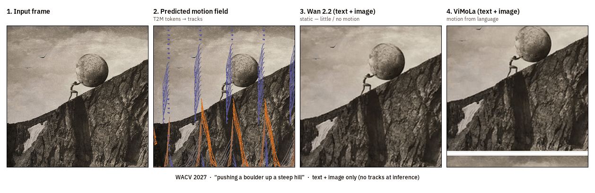

# ViMoLa: Discrete Motion Tokens for Language-Guided Video Generation

[](https://wacv2027.thecvf.com/)
[](https://bishoymoussa.github.io/ViMoLa.io/)
[](https://github.com/ostadabbas/ViMoLa)
[](https://huggingface.co/bishoygaloaa/ViMoLa)
[](LICENSE)

**Accepted at WACV 2027**

| Resource | Link |
|---|---|
| **Project page** | https://bishoymoussa.github.io/ViMoLa.io/ |
| **Code (this repo)** | https://github.com/ostadabbas/ViMoLa |
| **Model weights** | https://huggingface.co/bishoygaloaa/ViMoLa |
| **Lab** | [Augmented Cognition Lab](https://web.northeastern.edu/ostadabbas/) · Northeastern University |

**ViMoLa** (*Video Motion Language*) predicts discrete motion tokens from text and injects them into a **frozen** Wan 2.2 image-to-video backbone. Language is the only interface at inference — no tracks, drags, or camera paths.

| | |
|---|---|
| **Paper** | *ViMoLa: Discrete Motion Tokens for Language-Guided Video Generation* |
| **Authors** | Bishoy Galoaa, Sarah Ostadabbas (Northeastern University) |

---

## Teaser

Same first frame and prompt. Frozen Wan stays nearly static; ViMoLa predicts a motion field from the caption and produces the uphill motion — **no trajectories at inference**.



**Prompt:** *“pushing a boulder up a steep hill”*

1. **Input frame** — conditioning image  
2. **Predicted motion field** — T2M discrete tokens decoded to trajectories  
3. **Wan 2.2** — text + image only (little / no motion)  
4. **ViMoLa** — same text + image, with motion tokens  

---

## What is included

```
vimola/
├── assets/                 # teaser GIF / stills
├── vimola/
│   ├── inference/          # end-to-end generation
│   ├── tokenizer/          # spatial VQ-VAE (motion tokens)
│   ├── motion_model/       # text→motion + Wan adapters
│   ├── training/           # train tokenizer / T2M / adapters
│   └── data/               # dataset helpers
├── scripts/
│   ├── download_weights.py
│   └── infer.sh
├── requirements.txt
└── README.md
```

**Released weights** (Hugging Face):

| File | Role |
|------|------|
| `checkpoints/tokenizer.pt` | Spatial motion VQ-VAE |
| `checkpoints/t2m.pt` | Text-to-motion transformer |
| `checkpoints/adapters.pt` | Zero-gated Wan adapters (headline WACV model) |

You also need the public **Wan 2.2 TI2V 5B** Diffusers checkpoint (not redistributed here).

---

## Quick start

### 1. Install

```bash
git clone https://github.com/ostadabbas/ViMoLa.git
cd ViMoLa
python -m venv .venv && source .venv/bin/activate
pip install -r requirements.txt
```

### 2. Download ViMoLa weights

```bash
python scripts/download_weights.py --out checkpoints
```

Or with the Hub CLI:

```bash
hf download bishoygaloaa/ViMoLa --local-dir .
```

### 3. Get Wan 2.2 TI2V

```bash
hf download Wan-AI/Wan2.2-TI2V-5B-Diffusers --local-dir models/Wan2.2-TI2V-5B-Diffusers
```

### 4. Run inference

```bash
export PYTHONPATH=$PWD
bash scripts/infer.sh assets/sisyphus_input.png "pushing a boulder up a steep hill"
```

Or:

```bash
python -m vimola.inference.generate \
  --wan_dir ./models/Wan2.2-TI2V-5B-Diffusers \
  --adapter_ckpt ./checkpoints/adapters.pt \
  --tokenizer_ckpt ./checkpoints/tokenizer.pt \
  --t2m_ckpt ./checkpoints/t2m.pt \
  --image ./assets/sisyphus_input.png \
  --prompt "pushing a boulder up a steep hill" \
  --output_dir ./outputs/demo \
  --adapter_strength 0.1 \
  --num_frames 49 --height 480 --width 832 --seed 42
```

**Tips**

- `--adapter_strength 0.1` is the recommended default (motion vs. quality).
- Use a GPU with ≥40 GB VRAM for 49 frames at 480×832 (or enable CPU offload / fewer frames on smaller GPUs).
- `--motion_source none` (or `--no_motion`) runs frozen Wan without adapters.

---

## Method (short)

1. **Tokenizer** — compress a 32×32 CoTracker field into **64 discrete motion tokens**  
2. **T2M** — predict those tokens from a text embedding (~28M params)  
3. **Adapters** — zero-gated cross-attention into every frozen Wan DiT block via hooks (no backbone edit)

At inference: **text + first frame only**.

---

## Citation

```bibtex
@inproceedings{galoaa2027vimola,
  title     = {ViMoLa: Discrete Motion Tokens for Language-Guided Video Generation},
  author    = {Galoaa, Bishoy and Ostadabbas, Sarah},
  booktitle = {IEEE/CVF Winter Conference on Applications of Computer Vision (WACV)},
  year      = {2027}
}
```

---

## Links

- **Project page:** https://bishoymoussa.github.io/ViMoLa.io/  
- **Code:** https://github.com/ostadabbas/ViMoLa  
- **Model weights:** https://huggingface.co/bishoygaloaa/ViMoLa  
- **Lab:** [Augmented Cognition Lab](https://web.northeastern.edu/ostadabbas/) · Northeastern University

## License

Code: MIT (see [LICENSE](LICENSE)).  
Wan 2.2 weights follow their upstream license. Training data: Something-Something V2 / Kinetics-400 (use under their terms).
